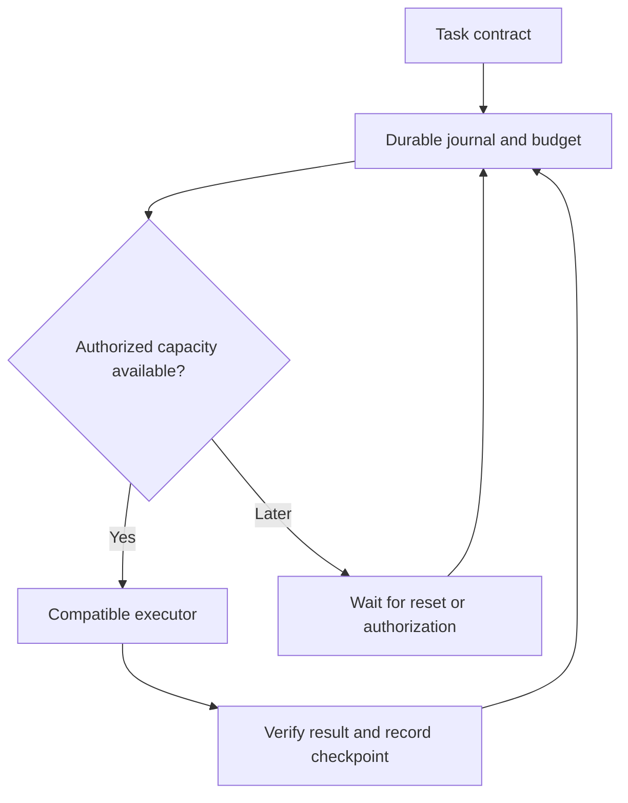

# XGuard execution continuity: scope and architecture

Status: capacity foundation implemented; portable multi-provider execution is a proposed next product, not a shipped guarantee.

## Production problem confirmed on 2026-11-09

The 2026-11-08 monitor recorded `storage_read_quota_exhausted` on /healthz and paid purchase readiness. The provider request audit did not establish SQL read utilization; it only showed request usage below its own request threshold. Requests and SQL row reads are independent allowances.

The existing CI fixture reports 51,188 SQL rows per full catalog refresh at 10,240 facts. At 96 refreshes/day, that projects to 4,914,048 SQL reads/day before source refreshes, customer facts, financial state or other Workers. This fixture is evidence of a capacity hazard, not a measurement of current account-wide production usage.

## Implemented capacity foundation

1. Catalog refresh pacing is computed from measured rows in the persisted snapshot. Allocate a local 1,000,000-row/day component budget and 25% growth margin. A small catalog keeps the 15-minute minimum; the 51,188-row fixture moves to 5,529 seconds and approximately 800,000 catalog rows/day. Snapshot timestamps and pacing survive eviction. UTC day boundaries and authenticated owner invalidation still refresh the snapshot.
2. Public /healthz reports catalog_capacity and the effective aggregate_interval_seconds. Freshness is explicit: aggregate indexes may refresh less often; individual fact reads still use the existing authoritative per-record verification and freshness checks. Traffic, URLs, crawler access and payment amounts are unchanged.
3. Source demand lookup seeks the existing (day,path,...) primary key for the current and previous UTC days. The isolated real-workerd fixture reads 6 rows instead of 8,192 with the same result. This is not an account-wide saving percentage.
4. No database schema, financial binding, migration, subscription, treasury address or settlement secret changes. Financial admission remains fail-closed if authoritative durable state cannot be read or written.

These changes reduce avoidable work. They do not create extra Cloudflare entitlement, hard-reserve account-wide quota, establish actual revenue or guarantee 24-hour service within a fixed free plan.

## Product objective

One HTTP/MCP task contract with recoverable progress across explicitly authorized executors. A developer submits the objective, permitted adapters, acceptance checks, deadline and spend cap. XGuard records progress and can continue unfinished eligible steps without silently repeating already accepted effects or charging for a replacement purchase.

This should extend the existing bounded task/checkpoint and signed-receipt mechanisms. The current service supports at most 3 public-read executions. It does not yet run arbitrary AI workloads, move private provider sessions or transfer unexposed model state.

## Execution record

A versioned task record contains tenant identity, adapter/version, normalized input digest, artifact references, dependency edges, scoped authorization reference, budget reservation, next eligible run time, completed-step receipts and acceptance results. Credentials stay in the secretless vault; the portable record never contains reusable upstream keys, browser cookies or hidden model state. Authorization is checked again at the destination executor.

## Components to implement before a multi-provider claim

| Component | Required behavior |
| --- | --- |
| Capacity planner | Distinguish quota reset, throttling, billing block, resource limits and semantic failure. Honor Retry-After; refuse to create capacity from nonexistent entitlements. |
| Durable task journal | Atomically record accepted checkpoints; resume after reconnect without recreating a paid task. Record uncertain external effects rather than assuming failure. |
| Executor adapters | A verified capability contract per provider or customer-owned runner. Provider substitution requires compatible inputs/outputs, customer permission and budget. A fallback URL alone does not prove equivalence. |
| Effect ledger | Use provider idempotency/reconciliation for side effects. If an outcome is unknown, stop or reconcile; never promise universal exactly-once execution on arbitrary APIs. |
| State outside the failed provider | An independently authorized durable coordinator is required to survive total Cloudflare account/service exhaustion. More namespaces or Workers in the same account do not isolate the shared allowance. |
| Independent ingress | A reachable alternative API path and tested routing are required for full Worker exhaustion. Static assets can keep approved public pages available only when asset routing avoids invoking the exhausted Worker. |
| Verification and receipts | Validate outputs against the customer's explicit checks. Sign execution evidence and provide a failure classification, actual known costs and recovery status. A signature alone does not prove correctness. |

This design respects provider quotas and permissions. It does not use fake accounts, identity rotation, CAPTCHA bypass, hidden sessions or unauthorized redistribution of customer data. Waiting or switching to approved capacity cannot remove a hard entitlement limit or provide unlimited compute for free.

## What can make the product defensible

Durable execution and replay already exist in systems such as Temporal; claiming that checkpoints are unprecedented would be false. A defensible XGuard product must demonstrate adapter correctness, safe payment/effect recovery, portability, verified completion and measurable cost savings across real customer workflows. Compatibility data and operational quality may create an advantage; no technical design guarantees exclusivity or demand.

Acceptance benchmarks for the next product:

- Interrupt a long task after a known checkpoint, reconnect and verify that accepted read steps are not fetched again.
- Simulate a 429 with a reset hint; verify no attempt occurs before the permitted time.
- Exhaust the primary provider while keeping independent coordinator/ingress available; finish on explicitly authorized equivalent capacity.
- Lose a response after an external side effect; verify reconciliation or fail-closed behavior before any retry.
- Demonstrate tenant isolation, revoked authorization and a hard customer spending cap.
- Report actual completed tasks, failure classifications and bills; do not advertise speculative success rates or guaranteed earnings.

## Sources

- Cloudflare Durable Objects pricing and free daily reset: https://developers.cloudflare.com/durable-objects/platform/pricing/
- Workers CPU, request and subrequest limits: https://developers.cloudflare.com/workers/platform/limits/
- Workflows limits and shared request allowance: https://developers.cloudflare.com/workflows/reference/limits/
- Static asset routing and billing: https://developers.cloudflare.com/workers/static-assets/billing-and-limitations/
- Temporal durable workflow replay: https://docs.temporal.io/workflows

## Rollback point

Pre-change Git commit: 98c3afca5389e5d0cb16720a8d854d9bf0f28101.
Observed production Worker version: b7d3ba18-bdf7-4202-a13c-468360eb6521.
Preserved branch: rollback/pre-capacity-20261109.
