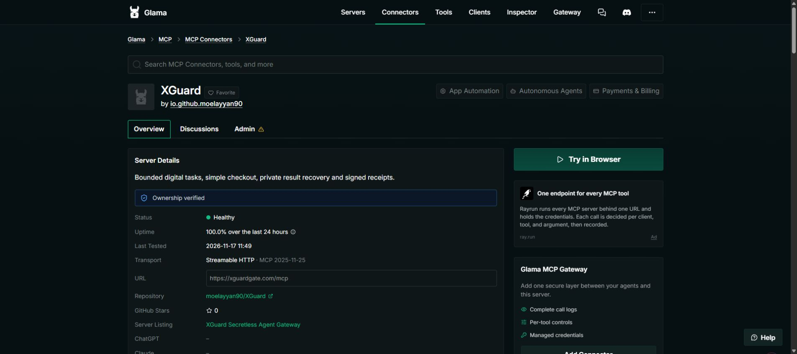

# نتيجة إصلاح Glama في XGuard

تاريخ التحقق: 2026-11-17، نحو 11:50 بتوقيت الأردن.

تم نشر الإصلاح على الإنتاج، وقبلت Glama إثبات الملكية للإدراجين. نُفذ فحص اتصال حقيقي من لوحة Glama بعد النشر وظهرت حالة Healthy للنطاقين.

## السبب الجذري

تغيّر مدخل Worker من سلسلة المدخل السابق إلى `src/live-entry.js` في Commit `88aad38f` بتاريخ 2026-10-04. بقي معالج Glama القديم في `src/entry.js` خارج سلسلة الطلبات الفعلية، فوصل المسار إلى قاعدة `/.well-known/*` العامة التي تعيد صفحة تقاعد الخدمة بحالة 410.

استُعيد رمز الملكية الحقيقي من لوحة حساب المالك داخل Glama، ونُشر وفق مخطط connector.json. لا يتضمن هذا التقرير قيمة الرمز.

## الإصدار المنشور

| العنصر | القيمة |
| --- | --- |
| Worker | `xguard-mainnet` |
| Commit الإنتاج | `e7abd2d355335d3ff6a60692032d6a6be253099e` |
| وسم الإنتاج | `git-e7abd2d35533` |
| إصدار Worker | `f1ef6505-c170-4982-8e4b-f88e3f1da78f` |
| إصلاح الملكية | [PR #621](https://github.com/moelayyan90/XGuard/pull/621) |
| إصلاح تحديث MCP Registry | [PR #620](https://github.com/moelayyan90/XGuard/pull/620) |
| نشر الإنتاج | [سجل النشر الناجح](https://github.com/moelayyan90/XGuard/actions/runs/44048825781) |

## نتائج الإنتاج

| النطاق | المسار | النتيجة |
| --- | --- | --- |
| xguardgate.com | `/.well-known/glama.json` | 200، JSON صالح، الرمز الحقيقي مطابق |
| xguardgate.com | `/mcp/.well-known/glama.json` | 200، JSON صالح، الرمز الحقيقي مطابق |
| api.xguardgate.com | `/.well-known/glama.json` | 200، JSON صالح، الرمز الحقيقي مطابق |
| api.xguardgate.com | `/mcp/.well-known/glama.json` | 200، JSON صالح، الرمز الحقيقي مطابق |

فحوص GET أكدت عدم وجود إعادة توجيه أو طلب مصادقة، ومطابقة وسم الإصدار. فحص HEAD على الإنتاج أعاد 200 ونوع application/json. اختبارات HEAD لجميع المسارات نجحت أيضًا في Worker المبني قبل النشر.

- MCP: نجح البروتوكول 2026-07-28 والتوافق مع 2025-11-25، وظهرت 53 أداة. قائمة أدوات API مطابقة لقائمة النطاق الرئيسي.
- الحد المدفوع: أعاد الاستدعاء غير المدفوع 402، ورُفض إثبات الدفع غير الصحيح بحالة 400. لم تُنفذ حوالات أو مدفوعات حقيقية.
- A2A: نجحت بطاقة الوكيل والمحادثة وقراءة حقيقة منشورة، ورُفض التنفيذ المدفوع دون دفع.
- x402: نجحت بيانات facilitator ومسار supported ورفض المدخلات غير الصحيحة في verify وsettle.
- نجحت فحوص التسوية الحالية دون توقيع أو إنفاق، وفحوص C2SP وMCP Registry ونشر Worker.
- اجتازت الفحوص المحلية 120 اختبار سلوك قائمًا و5 اختبارات مركزة، إضافة إلى بناء Worker وفحوص runtime الفعلية.

## قبول Glama

| الإدراج | نقطة MCP | الإثبات |
| --- | --- | --- |
| [XGuard](https://glama.ai/mcp/connectors/io.github.moelayyan90/xguard) | https://xguardgate.com/mcp | Ownership verified؛ بريد رسمي يؤكد الإدارة عند 11:43 بتوقيت الأردن |
| [XGuard — Agent Execution Gateway](https://glama.ai/mcp/connectors/io.github.moelayyan90/xguard-control-plane) | https://api.xguardgate.com/mcp | Ownership verified؛ بريد رسمي يؤكد الإدارة عند 11:44 بتوقيت الأردن |

نجح Test Connection داخل Glama للنطاق الرئيسي عند 11:49:54، ولـ API عند 11:49:26، وظهرت Healthy. هذا قبول فعلي من Glama إضافة إلى اختبارات HTTP.

أُصلح أيضًا رفض MCP Registry للوصف الذي تجاوز 100 حرف؛ أصبح الوصف 84 حرفًا ونُشر الإصدار 6.1.0 بنجاح. طُوبق اسم الإدراج الرئيسي ووصفه وعنوانه مع السجل الرسمي، مع إبقاء السجل مصدر تحديث البيانات.

## الملفات المعدلة

| الملف | التغيير |
| --- | --- |
| `.well-known/glama.json` | الرمز الرسمي المرتبط بحساب المالك |
| `apps/relay/src/glama-ownership.js` | معالج إثبات عام محدود، دون تخزين أو اتصال خارجي |
| `apps/relay/src/live-entry.js` | معالجة الإثبات قبل التوجيه العام |
| `apps/relay/test/glama-ownership.test.mjs` | اختبارات JSON والأساليب والوصول وفشل الإعدادات |
| `apps/relay/test/glama-workerd.mjs` | اختبار Worker المبني وإثبات انعدام اتصالات التخزين والمصادر |
| `scripts/glama-production-check.mjs` | فحص إنتاج محدود دون تسجيل قيمة الرمز |
| `scripts/glama-production-check-test.mjs` | رفض 200 الزائف والرمز غير المطابق وإعادة التوجيه |
| `.github/workflows/ci.yml` | تضمين الاختبارات المركزة واختبار runtime |
| `.github/workflows/deploy.yml` | حاجز قبل النشر وفحص بعده وربطه بالتراجع الآمن |
| `docs/operations/glama-emergency-repair-20261117.md` | تشخيص وخطوات التحقق والتراجع |
| `server.json` | وصف متوافق مع حد MCP Registry |
| `scripts/live-check.mjs` | منع تكرار تجاوز حد الوصف |

## السجلات وحدود التحقق

لم تظهر في السجلات التي روجعت أخطاء تخص معالج Glama. ظهرت استجابات 503 متوقعة من فحوص النشر الاصطناعية لمسارات compute وشراء خدمة escrow غير المفعّلة؛ كانت نتيجة تنفيذ Worker فيها ok. لا يصح وصف جميع سجلات المنصة بأنها خالية من 503.

لم تُغيّر أسعار أو عقود الدفع أو مخططات Durable Objects أو أدوات MCP/A2A. بقيت إمكانية العودة إلى إصدار Worker السابق ضمن آلية التراجع الموجودة.

لا توجد خطوة صلاحيات معلقة لإثبات ملكية الإدراجين في نطاق هذا الإصلاح.
